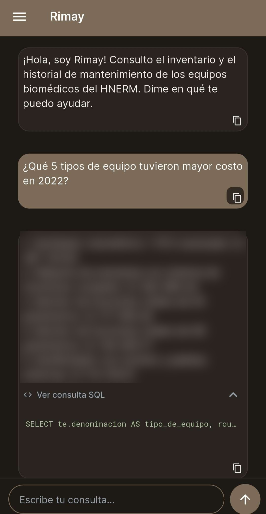

# Portafolio

## Sobre mí

Soy **ingeniera biomédica** (PUCP – UPCH) orientada a la **ciencia de datos**. Me especializo como **Data Scientist** y desarrollo modelos de machine learning, bases de datos y aplicaciones con inteligencia artificial para el sector salud. He trabajado en la automatización de procesos de seguros de salud, en la investigación en procesamiento de lenguaje natural y en el desarrollo de una aplicación con IA para la gestión del mantenimiento de equipos biomédicos hospitalarios. Actualmente curso la **Diplomatura en Estadística Aplicada** en la PUCP.

**Contacto:** [LinkedIn](https://www.linkedin.com/in/claudia-cg/) · [GitHub](https://github.com/Grimalo) · clarox184@gmail.com

---

## Proyectos

### 1. Rimay: consulta en lenguaje natural para la gestión del mantenimiento biomédico

**Repositorio:** [rimay-nl2sql](https://github.com/Grimalo/rimay-nl2sql)

Aplicación móvil que permite al personal de ingeniería clínica consultar **en lenguaje natural** el historial de mantenimiento de un hospital nacional: **7 872 órdenes de trabajo de 1 412 equipos biomédicos** (83 tipos de equipo, 2019–2022). El usuario escribe una pregunta, un modelo de lenguaje la convierte en SQL, el SQL se valida y se ejecuta sobre PostgreSQL, y la app muestra la respuesta junto con la consulta ejecutada para que sea verificable.

| Inicio de sesión | Respuesta con la consulta SQL | Historial de conversaciones |
|:---:|:---:|:---:|
|  |  |  |

- **Aplicación móvil** en FlutterFlow (Flutter/Dart) con registro, verificación de correo, inicio de sesión con Google, historial por usuario y modo claro y oscuro.
- **Base de datos** PostgreSQL (Supabase) con un modelo relacional normalizado, seguridad a nivel de fila (RLS) y un rol de solo lectura.
- **Backend serverless** en Supabase Edge Functions (TypeScript): flujo Text-to-SQL con la API de OpenAI y salida estructurada, validador de seguridad del SQL, bitácora de consultas e historial de conversaciones.
- **Evaluación** con 45 preguntas mediante scripts en Python: 86 % de exactitud de ejecución y 100 % de rechazo de consultas no permitidas (inyección SQL, modificación de datos).

`FlutterFlow` `Supabase` `PostgreSQL` `TypeScript` `OpenAI API` `Python`

---

### 2. Triaje y trazabilidad automática de correos para SCTR Salud — MAPFRE Seguros

Sistema para clasificar y dar seguimiento a más de 200 correos diarios del área de SCTR Salud (≈ 1 700 casos):

- Más de 25 flujos en **Power Automate** y scripts en **TypeScript** (Office Scripts) para registrar y dar seguimiento a cada caso.
- **Agentes de IA** en Copilot Studio y AI Builder: clasificación en 24 categorías con umbral de confianza, redacción de respuestas y derivación a revisión humana.
- Modelo de **extracción por OCR** con 98 % de exactitud para digitalizar informes médicos no estructurados.
- **Dashboards en Power BI** para medir tiempos de respuesta y cargas de trabajo.

`Power Automate` `Copilot Studio` `AI Builder` `Power BI` `TypeScript`

*Proyecto corporativo: el código y los datos no son públicos.*

---

### 3. Procesamiento de lenguaje natural para salud mental — PUCP

Investigación en dos grupos de la PUCP:

- **Distorsiones cognitivas** (Laboratorio de Procesamiento Digital de Señales): traducción y sistematización al español de 6 bases de datos, y entrenamiento de un modelo basado en **RoBERTa** para identificarlas.
- **Trastornos mentales** (Grupo de Inteligencia Artificial): recolección y procesamiento de datos de fuentes abiertas, y entrenamiento de un modelo basado en **BERT**.

`Python` `PyTorch` `Hugging Face` `Transformers`

---

### 4. Modelo de elección del medio de pago — Grupo MOR Perú (Aquamundo)

Modelo de **regresión logística** sobre datos transaccionales que predice el medio de pago (tarjeta, billetera digital, POS) según el canal de venta, con **92 % de exactitud**.

`Python` `scikit-learn` `Pandas`

---

## Habilidades

- **Lenguajes:** Python, SQL, TypeScript, JavaScript, Dart, C++
- **Desarrollo de aplicaciones:** FlutterFlow (Flutter), Supabase Edge Functions, APIs REST, integración con modelos de IA
- **Bases de datos:** PostgreSQL, Supabase (Auth, RLS), modelado relacional
- **Ciencia de datos e IA:** Machine Learning, Deep Learning, NLP, scikit-learn, PyTorch, TensorFlow, Hugging Face, Pandas, Spark
- **Power Platform:** Power BI, Power Automate, Power Apps, Copilot Studio, SharePoint
- **Nube:** Supabase, AWS, Azure, Google Cloud

## Formación

- **Ingeniería Biomédica** — Pontificia Universidad Católica del Perú y Universidad Peruana Cayetano Heredia
- **Diplomatura en Estadística Aplicada** — PUCP (en curso)
- Data Scientist in Python y Data Scientist Associate with Python — DataCamp
- Cloud Computing: AWS, Azure y Google Cloud — Universidad Nacional de Ingeniería
- Inteligencia Artificial en la Salud — Instituto Nacional de Salud
